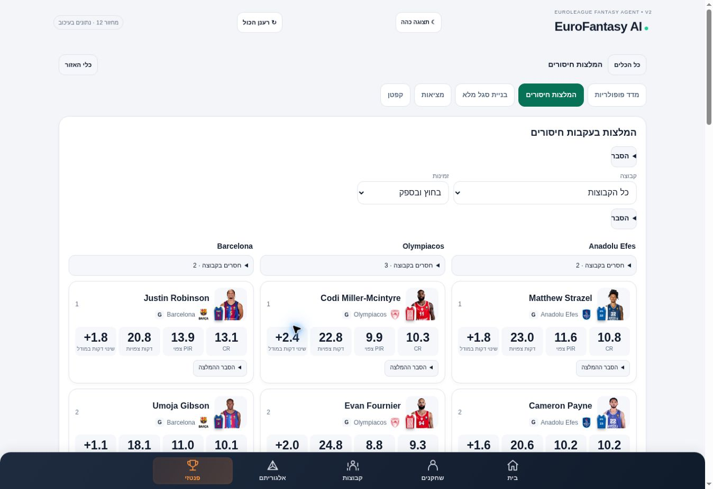
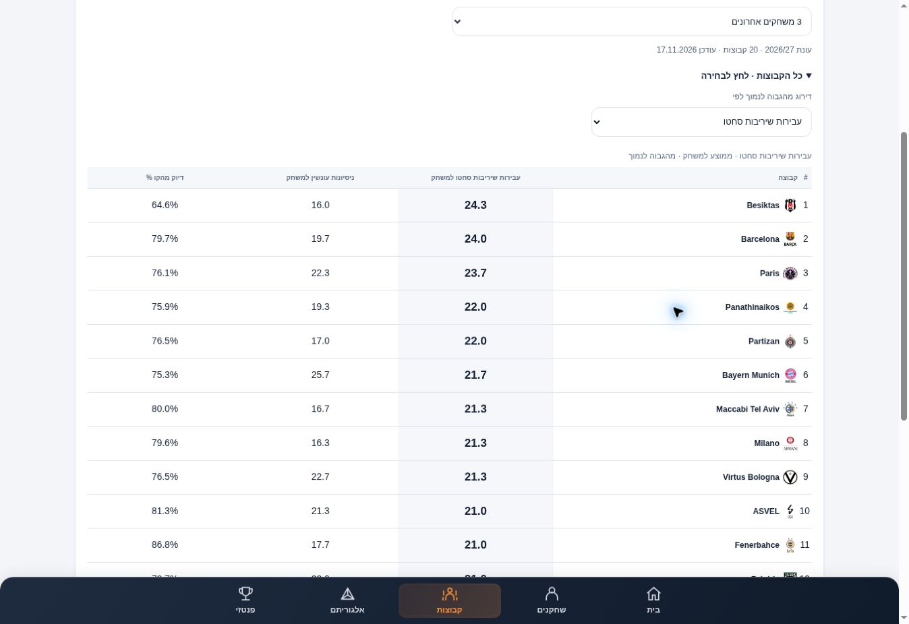
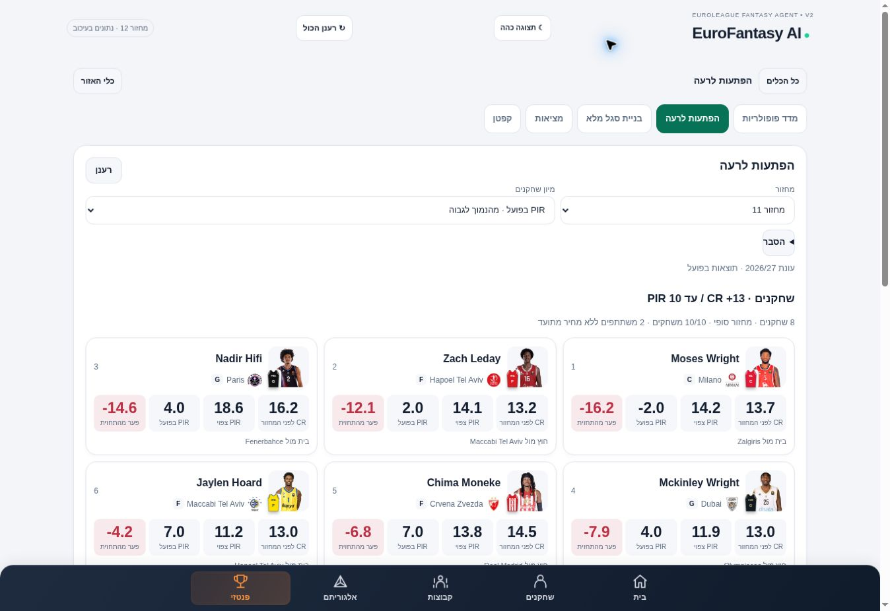

# Compact fantasy tools — E2026 / 2026–27

## Changes

- `index.html`: absence recommendations use compact player headers, four clearly labelled statistics, canonical profile actions and collapsed recommendation/missing-player explanations. `absenceGroups`, `model` and recommendation ordering are unchanged.
- `fantasy-compact.js`: shared identity-first profile/media rendering; resolves the registry key to exactly one current market player before invoking the existing `showPlayer`. No fuzzy name join or new profile implementation.
- `fantasy-compact.css`: scoped light/dark cards and compact team table, based on existing theme tokens, fonts and market proportions. No navigation changes.
- `free-throws.js`: team ranking table, descending active metric with canonical team ID tie break and missing values last. All five team metrics remain selectable; makes and attempts stay per-game, accuracy remains a percentage. Clicking any team row opens existing team details. Source selection and summary formulas are unchanged.
- `surprises.js`: credit descending, actual PIR ascending and actual-minus-forecast ascending. Keeps the exact played/position/13+ credit/10-or-lower PIR filter and round selector. Reads existing pre-round E2026 prediction archives, validating round and timestamp; duplicates, missing identities and invalid snapshots produce an em dash. Never recalculates a historical forecast using today's model.
- `tests/test_fantasy_compact.cjs` and the existing identity/Pages workflow: regression coverage added to the normal publication checks.

## Validation completed before publication

- All changed JavaScript and 12 inline scripts parse.
- Compact regression suite passed: all 11 available rounds, all three numeric sorts, ties/missing values, Baldwin alias identity, duplicate/wrong-season/late-snapshot guards, 60 team/range combinations.
- Existing `test_surprises.cjs` passed, including official rank reconciliation and same-day leakage guards.
- Existing `test_team_metrics.cjs` passed: 20 teams and 110 results.
- Separate baseline comparison against commit `2af19d07b5d06e0cb938a562c21afeb06fc6e803`: surprise membership/results identical for all 11 rounds; all 60 team/range summaries deeply equal. No forecast, price or source-data files changed.
- Browser: absence screen inspected at 375, 390 and 430 CSS pixels with no horizontal overflow; long English names, four metric columns and collapsed explanations inspected. Shirt action opened Matthew Strazel's existing profile. Final checks and publication evidence are reported in the completion message.

## Known data and verification limits

- Round 1 has no valid pre-round prediction archive. Its forecast/gap cells deliberately display an em dash. All selected players in rounds 2–11 have matched archived predictions.
- A genuinely absent portrait falls back to the team's shirt.
- Local broad identity/forecast suites require the large advanced-player dataset, which the connector could not transfer. They run in the existing GitHub Actions publication workflow with the complete repository. Browser connection timeouts limited local interactive verification; unverified checks must not be reported as passed.

## Continuation verification — 18 November 2026

### Publication confirmed

Implementation commit: `2e054b3e24ec8dc4fa2e5e33e5dce523f61dafcc`.
[GitHub Actions run 44142283320](https://github.com/rotemkimi-byte/eurofantasy-ai/actions/runs/44142283320) completed successfully: identity/forecast regression, real mobile profile/advanced-tool checks, artifact upload and Pages deployment all passed. The redesigned tools were also verified directly on the public site on 18 November. This continuation documents that already successful publication; it does not claim a new deployment.

### Live interaction checks completed

- Absence recommendations: compact four-stat cards and collapsed explanations render. Matthew Strazel's shirt opens his existing profile with the correct name and team; returning restores the recommendation screen. The recommendation explanation opens in its own card.
- Negative surprises: round 11 shows eight players; PIR ascending begins Moses Wright (-2), Zach Leday (2), Nadir Hifi (4). Credit descending begins Mathias Lessort (16.7), Nadir Hifi (16.2), Walter Tavares (15.2). Moses Wright's shirt opens his existing profile; returning preserves the selected round and sort.
- Team fouls: all 20 teams appear in descending order. Last-game ranking begins Paris (28.0). Clicking Paris selects the same team and shows its per-game details. Switching to three games changes Paris to 23.7 and the leader to Besiktas (24.3); the table reorders correctly.
- Screenshots below show the actual light-theme public site at desktop width. No additional mobile-width browser run was performed in this continuation; the earlier 375/390/430px absence checks and the successful CI mobile checks are distinguished above.

### Current-source regression and limits

On repository head `7b6e16c7e4c230da481dbc3146af264707f2525e`, the compact, surprises and team-metrics suites pass: 11 completed round reports, three sorts, archived-forecast guards, 60 team/range summaries, 12 inline scripts, and 20 teams / 114 results. Round 12 has no player round report yet; the live surprise screen displays that absence explicitly.

A new broad identity run does **not** pass: `test_player_identity.cjs` fixes the acceptance sample to 11 appearances, but the official source now contains 12. Rebuilding the registry also differs from the checked-in generated registry after subsequent data updates. These are separate current-data verification issues, not a successful re-run of all regression suites.

Additionally, the latest inspected scheduled rolling-learning run, [44232473611](https://github.com/rotemkimi-byte/eurofantasy-ai/actions/runs/44232473611), stops at its integrity audit: Rolands Smits (`007109`) and Kenan Kamenjas (`008325`) have registry links without matching official profiles in that run. Its deployment was skipped. No integrity guard was bypassed or weakened. This later failure does not undo the confirmed successful UI deployment above, but automated data publication remains an outstanding issue.

### Live screenshots

