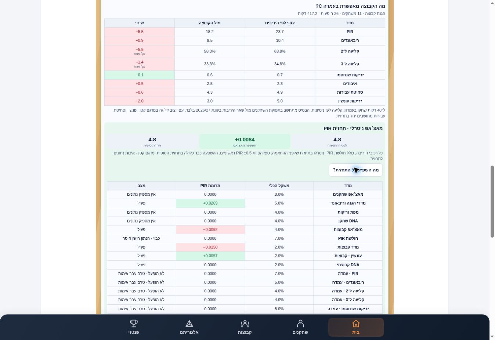

# תיקון חישוב מאצ׳אפ — דוח ביצוע, 17.11.2026

בוצעו תיקוני חישוב, הפרדה מלאה של רכיבי היריבה, החלפת מקור נתוני העמדה ותצוגת תרומות. ההרחבה החיזויית לפי עמדה נבנתה ונבדקה אך **לא הופעלה**, מפני שלא הוכיחה שיפור כרונולוגי. הסרת נתון E2025 היא תיקון תקינות מקור, ואינה מוצגת כשיפור מוכח בדיוק.

## השינויים שפורסמו

- ההפרש מחושב מהתחזיות הגולמיות לפני עיגול. ההשפעה מוצגת בארבע ספרות אחרי הנקודה; התחזיות המדויקות זמינות בפירוט.
- מעל ‎+0.5: חיובי; מתחת ‎−0.5: קשה; הטווח הסגור שביניהם: ניטרלי.
- תחזית לפני התאמה מנטרלת את תשעת רכיבי היריבה: מאצ׳אפ אישי, הגנה וריבאונד, קליעה, DNA שחקן, קצב קבוצתי, חולשת PIR, יעילות הגנתית קבוצתית, סחיטת עבירות ו־DNA קבוצתי. בית/חוץ נשאר בבסיס.
- כפתור ״מה השפיע על התחזית?״ מציג משקלי כלים, תרומות PIR, נתונים חסרים, רכיבים כבויים וסכום תואם. התחשבות ברצפת 0 PIR משויכת באופן יחסי ומסומנת כשנדרש.
- המשקלים האישיים נשמרו; רכיב חסר או לא מאומת אינו מחלק את משקלו מחדש לכלים אחרים.
- נשמרה פריסת האופטימייזר; נוספה רק פתיחת פירוט קומפקטית בתוך ניתוח היריב.

## מקור נתוני העמדה

`data/position-matchups.json` נבנה מחדש מתוך 110 משחקים ו־2,482 הופעות עם דקות חיוביות בעונת E2026 בלבד. המדד מחושב בנפרד ל־G/F/C. אין נפילה אוטומטית ל־E2025 ואין תלות במאגר DuckDB חיצוני שמתעדכן באיחור.

החישוב כולל דקות שחקן בפועל, מספר משחקים, זמינות כל שדה, שיעורי קליעה משוקללים לניסיונות ואיכות שחקני היריבות. לכל הופעה מחושבת תפוקה צפויה לפי אותו שחקן מול יריבות אחרות, עם prior ליגה של 80 דקות; אמינות המדגם היא games/(games+8). אלו קבועי ייצוב תיאוריים, לא מקדמי גובה/משקל ולא הבטחה לתוקף חיזויי.

הטבלה מציגה ספירות ל־40 דקות שחקן בעמדה; אחוזי קליעה נשארים אחוזים. ״צפוי לפי היריבים״ אינו ממוצע פשוט של כלל השחקנים. חסר נשאר חסר ולא הופך לאפס. השפעת חולשת PIR מהמקור הישן הוסרה מהחיזוי. המדד החדש נשאר תיאורי עד אימות.

העדכון משולב בתהליך נתוני הבוקס־סקור הרשמי המתוזמן בדקות 19 ו־49 בכל שעה, וכן בגיבוי יומי. הנתונים נבנים אחרי קליטת משחקים שהושלמו. תוצאת משחק ושעת התחלה בתוספת ארבע שעות נדרשות כדי למנוע שימוש במשחק שעדיין מתנהל. אין התחייבות לעדכון מיידי בסיום המשחק.

## ההרחבה החיזויית שנבדקה

נבנו רכיבי PIR זרים זה לזה: ריבאונד, קליעה לשתיים ולשלוש כולל מחיר ההחטאה, זריקות שנחסמו, איבודים, סחיטת עבירות ועונשין, ויתרת PIR לאחר ניכוי הרכיבים האחרים. יתרת PIR מונעת הוספה כפולה של PIR הכולל ושל מרכיביו.

חשיפת השחקן נגזרת מפרופיל האירועים האישי המשותף לניתוח ה־DNA ולמודל המאוחד (`UnifiedForecast.statProfile`): תדירות זריקות, ריבאונד, איבודים ועונשין לדקה. לא נבנתה מערכת DNA מקבילה ולא נוספו שוב 80 המדדים כתרומות עצמאיות. בניסוי, רכיבי היריבה הישנים מוחלפים כמקשה אחת ולא מתווספים שוב למפת הזריקות או ל־DNA.

נלמד מקדם ridge יחיד, לא שלילי, בתקופת האימון בלבד. המקדם שנלמד היה **0**. לכן אין ראיה להפעלת התיקון החדש. מנגנון ההפעלה בודק גם את מדדי האימות ולא מסתמך על דגל activate בלבד. הקלטים הניסיוניים נתמכים בהקפאה ובשחזור תחזיות ובדוחות המשוקללים, כדי שהצגה ושחזור ישתמשו באותו חישוב אם מודל עתידי יעבור אימות מתאים.

גובה, משקל וחסימות/חטיפות אישיות אינם מקבלים מקדם PIR מומצא. השחקן המוצג הוא מוביל דקות זמין באותה עמדה, לא שומר ישיר מזוהה. אין נתוני שמירה מאומתים או מודל הקצאת שמירה בין שחקני הרוטציה, ולכן רכיב שומר ישיר נשאר ללא השפעה.

## הבדיקה הכרונולוגית

תקופת אימון שהוגדרה מראש: מחזורים 7–9; תקופת אימות נפרדת: מחזורים 10–11. נעשה שימוש בקלטי טרום־משחק מוקפאים ובגרסאות נתונים שפורסמו ב־Git לפני מועד החיתוך, כולל תאריך פרסום פנימי של הקבצים. תוצאות מטרה שימשו להערכה בלבד. כל תוצאות האימון והאימות הן E2026.

בפועל היו 438 תחזיות מ־20 משחקים לאימון ו־441 תחזיות מ־20 משחקים לאימות. עשרה משחקים הושמטו: שבעה ללא גרסת מקור שפורסמה לפני התחזית ושלושה ללא קלט מוקפא. הדוח אינו משלים אותם בעזרת נתונים עתידיים. זוהי הרצה של הליבה הנוכחית על קלטים היסטוריים, ולא הבטחה לשחזור כל גרסה שהוגשה באתר בעבר.

תנאי הפעלה שנקבעו מראש: לפחות 2% שיפור MAE מול המודל הקודם ומול הבסיס אחרי הסרת המקור הפסול, ללא הרעת RMSE וללא הרעה באף אחד משני מחזורי האימות. התנאים לא התקיימו.

| מודל — אימות בלבד | MAE | RMSE | שגיאות של 10 PIR ומעלה |
|---|---:|---:|---:|
| ליבה קודמת, כולל מקור העמדה הישן | 5.9856 | 7.5793 | 77 |
| לאחר הסרת רכיב E2025 הפסול | 5.9841 | 7.5822 | 76 |
| ניסוי הגנה לפי עמדה — כבוי | 5.9847 | 7.5857 | 76 |

הבדלי הדיוק קטנים ואינם מצדיקים טענה לשיפור. ה־MAE של תיקון המקור ירד בכ־0.0016, אך ה־RMSE עלה בכ־0.0030 לעומת הליבה הקודמת. אלה אינם שיפור מאומת במודל.

| קבוצה — אימות בלבד | N | MAE קודם | MAE תיקון מקור | MAE ניסוי | RMSE קודם | RMSE ניסוי |
|---|---:|---:|---:|---:|---:|---:|
| עמדה G | 191 | 6.1969 | 6.1927 | 6.1919 | 7.7642 | 7.7672 |
| עמדה F | 167 | 5.1806 | 5.1820 | 5.1824 | 6.6652 | 6.6712 |
| עמדה C | 83 | 7.1194 | 7.1179 | 7.1220 | 8.7814 | 8.7956 |
| הגנה strong | 206 | 6.2509 | 6.2589 | 6.2615 | 7.8129 | 7.8272 |
| הגנה weak | 235 | 5.7531 | 5.7432 | 5.7420 | 7.3684 | 7.3674 |

הגנה חזקה/חלשה מסווגת לפי יחס PIR מותאם לאיכות היריבות שהיה זמין לפני המשחק, בנפרד לעמדת השחקן. אין סיווג בדיעבד לפי תוצאת משחק המטרה.

ב־441 מקרי האימות ההשפעה הכוללת של רכיבי היריבה במודל הקיים נשארה בתוך ±0.5 PIR. לכן אין מדגם חיובי/קשה שמאפשר לאמת את הספים האלו; הם נשארו סיווג תצוגה ראשוני. אסור להציגם כמדד סיכון מאומת או לכייל אותם על אותם משחקי אימות.

20 הפספוסים הגדולים, מדדי MAE/RMSE לכל עמדה וסוג הגנה, תוצאות לכל מחזור, גרסאות מקור ומועדי חיתוך נמצאים בדוח JSON המצורף: [position-defense-validation.json](../data/learning/position-defense-validation.json).

## אוסמן דיופ מול הכוכב האדום

בדיקת הרגרסיה משמרת את הדוגמה שנמסרה: 4.7477 לפני ו־4.7561 אחרי מניבים ‎+0.0084, ולא ‎+0.1, ומסווגים ניטרלי.

בבדיקת הדפדפן עם הנתונים הנוכחיים התקבלו 4.7685 לפני ו־4.7769 אחרי, עם אותה השפעה ‎+0.0084 וסיווג ניטרלי. ערכי הבסיס השתנו עקב הסרת המקור ההיסטורי. טבלת התרומות הציגה ‎+0.0269 להגנה וריבאונד, ‎−0.0092 לקצב, ‎−0.0150 למדד הקבוצתי ו־‎+0.0057 לעונשין קבוצתי; סכומם ‎+0.0084. המדדים החדשים לפי עמדה הוצגו ככבויים עד לאימות.

נתוני C מול הכוכב האדום: 11 משחקים, 26 הופעות, 417.2 דקות. הטבלה הציגה PIR של 18.2 ל־40 דקות מול 23.7 צפוי לפי היריבים, בנוסף לריבאונדים, אחוזי 2/3, זריקות שנחסמו, איבודים, סחיטת עבירות ועונשין. אלו נתוני תיאור, ואינם לבדם הוכחה להפחתת PIR מסוימת לדיופ.

## בדיקות שבוצעו

- בדיקות E2026 בלבד, חיתוך בזמן, הזרקת תוצאה עתידית, כפילות משחקים, שקלול דקות, נתונים חסרים, עמדות ונתון דיופ הרשמי.
- בדיקת ההפרש הגולמי וספי ±0.5, נטרול כלל רכיבי היריבה, התאמת סכום התרומות גם עם רצפת 0 PIR ומשקלים אישיים.
- בדיקת הקפאה/JSON/שחזור של המודל הניסיוני, התאמה בין החיזוי לפירוט, ומניעת הפעלה באמצעות דגל ללא תוצאות תקפות.
- בדיקות רגרסיה של weighted forecast, unified forecast, defense, matchup context, player DNA, advanced players, algorithm evidence, capture, replay ו־personal model עברו.
- 30 בדיקות Python עברו; קובצי workflow עברו פענוח YAML ובדיקות JavaScript עברו בדיקת תחביר.
- בדיקת דפדפן בפועל: פתיחת הסגל, דיופ, ניתוח יריב ופירוט התרומות. לא בוצעה בדיקת viewport ייעודי לאייפון; נשמרו מבנה הכרטיסים וסגנונות הבסיס הקיימים.

## מגבלות והמשך

הטמעת המדדים בחיזוי נבנתה אך כבויה בכוונה. אין הבטחה לשיפור לכל שחקן או לקבוצה. האימות בדק משקלי ברירת מחדל; הוא אינו מאמת בנפרד כל צירוף משקלים אישי. אין לכייל גרסה חדשה שוב מול מחזורים 10–11 ולהציגם כאימות שלא נראה — נדרש מחזור עתידי נפרד או פרוטוקול כרונולוגי חדש.
